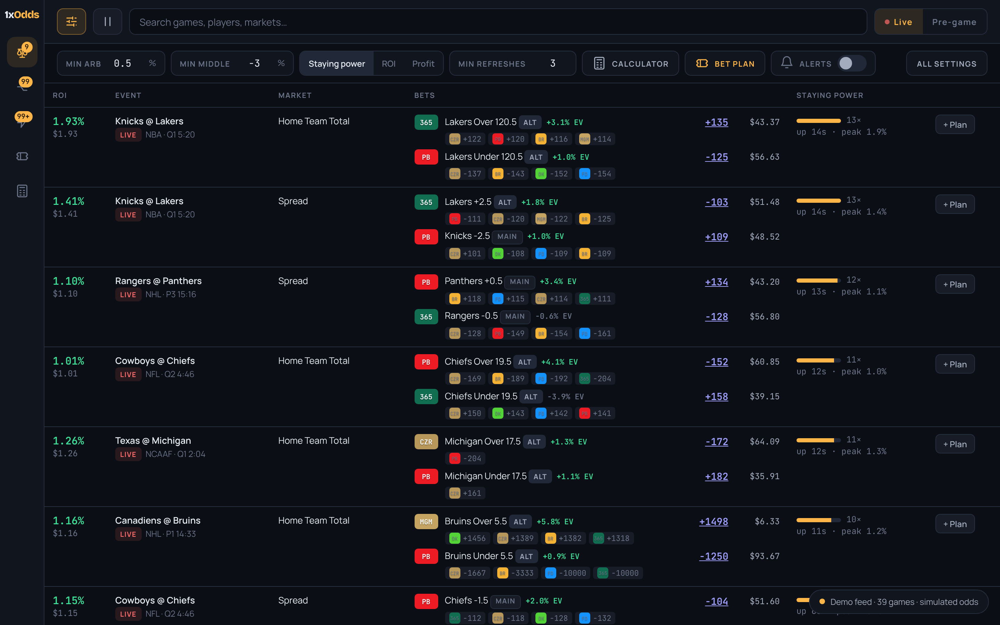
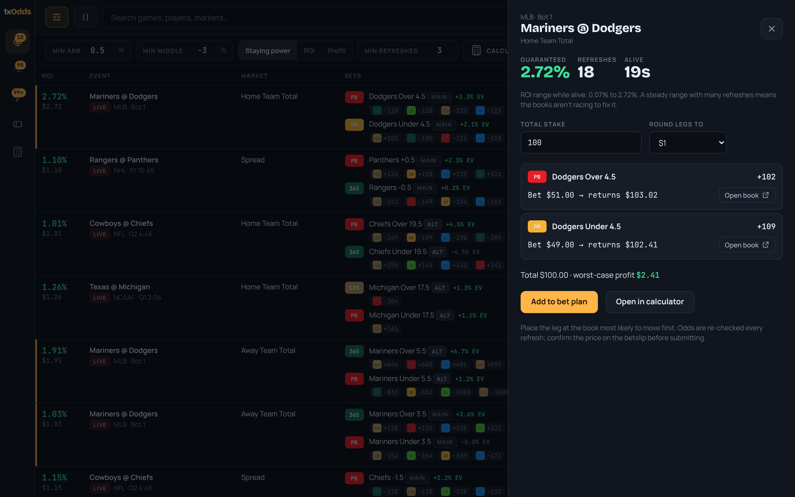
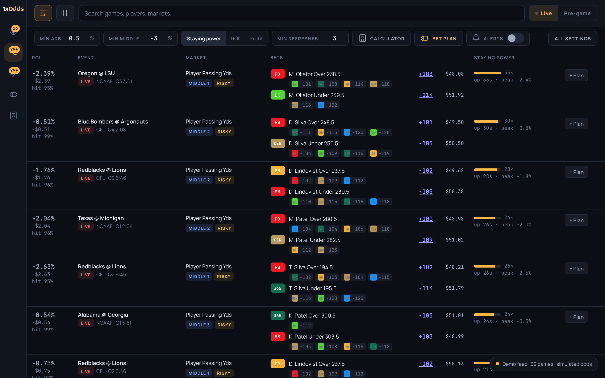
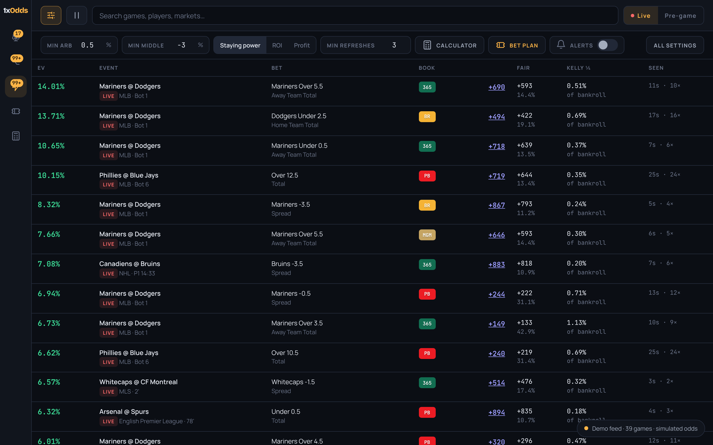
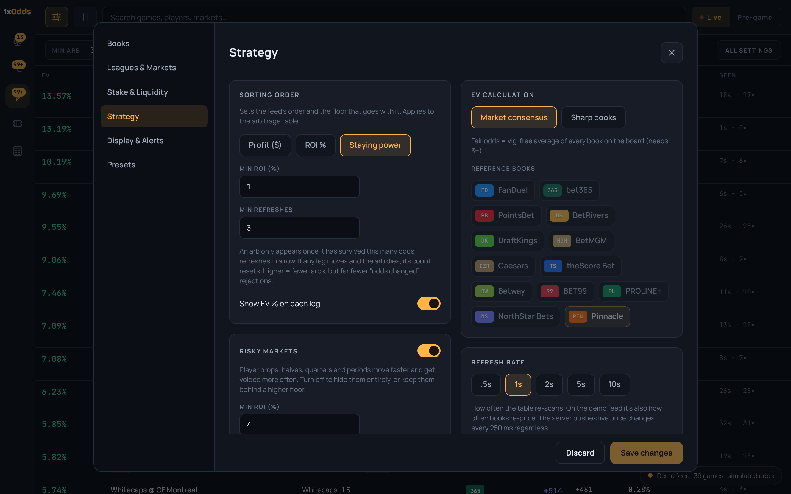

# 1xOdds

Live and pre-game arbitrage, middles and +EV across Ontario sportsbooks: FanDuel, bet365, PointsBet, BetRivers, DraftKings, BetMGM and Caesars (plus theScore Bet, Betway, BET99, PROLINE+, NorthStar Bets and Pinnacle as optional extras).



*Screenshots use the built-in demo feed (simulated odds).*

| Arb details and stake split | Middles |
|---|---|
|  |  |

| +EV bets | Strategy settings |
|---|---|
|  |  |

## Run it

```bash
npm install
npm run dev          # server on :8787 + UI on http://localhost:5173
```

With no API key it runs on the built-in demo feed (simulated odds), so you can try every feature right away.

Production: `npm run build && npm start` serves the UI and feed from one port.

## Real odds

1. Get a key from a licensed odds provider. The adapter included is for **SportsGameOdds** (REST + WebSocket push, covers FanDuel, bet365, DraftKings, BetMGM, Caesars, theScore Bet, Pinnacle and more).
2. `cp .env.example .env`, paste the key into `SGO_API_KEY`.
3. `npm run probe:sgo NHL` prints one raw event. Check the fields marked `VERIFY` in `server/adapters/sportsGameOdds.ts` against it (bookmaker ids, live filter, alt-line flag).
4. **Ontario vs US lines:** most feeds carry each book's *US* prices. Ontario prices for FanDuel, DraftKings, BetMGM etc. can differ. Ask your provider whether they offer Ontario-specific books before trusting arbs.

Other providers: write a class implementing `FeedAdapter` (`server/adapters/types.ts`) that pushes `{ events, quotes }` batches, and register it in `server/index.ts`. Everything downstream (diffing, push, engine, UI) stays the same.

### Why a licensed feed instead of scraping the books

Scraping FanDuel, bet365 etc. directly breaks their terms, gets blocked by their bot protection, and, worst for an arber, gets *your betting accounts* flagged and limited. A licensed feed is faster to build on, legal, and invisible to the books.

## How speed works

```
provider ──poll/stream──▶ adapter ──▶ Board (diff) ──250ms flush──▶ WebSocket ──▶ browser Engine ──▶ table
```

- Each league is polled on its own loop (live 1s, pre-game 10s by default) with back-off on rate limits. Use the provider's stream where your plan allows it.
- The board only sends **changed** prices, so a browser gets every move with tiny messages.
- Arbs are computed **in the browser** against each user's own books, floors and required books, so changing a filter re-scans instantly.

## Staying power & minimum refreshes

Every opportunity is tracked across scans. Each scan where it still exists (same books, same sides, still profitable) adds one **refresh**. If any leg moves and the arb disappears, its count resets to zero.

- **Min refreshes** hides arbs until they have survived N scans in a row. Arbs that flicker for one tick (the ones that give you "odds have changed" on the second leg) never reach you.
- **Staying power sort** ranks by refreshes survived, time alive, and how little the ROI has decayed from its peak.
- The detail drawer shows the ROI range while it's been alive.

## Feature map

| Area | What's there |
|---|---|
| Toolbar | Min arb %, min middle %, sort, min refreshes, calculator, bet plan, alerts switch, pause, search, Live / Pre-game |
| Books | Book selection, required books (at least one leg), per-book stake, disabled leagues, main-line-only leg |
| Leagues & Markets | 12 leagues incl. CFL, per-market toggles, search |
| Stake & Liquidity | Ratio or fixed stakes, arb and EV liquidity floors |
| Strategy | Sort by profit / ROI / staying power with matching floors, show EV %, risky-market floor, middles, EV via consensus or sharp books, refresh rate, main/alt tags |
| Display & Alerts | Soft/loud alerts for arbs and EV, comparable odds, details popup, popup vs tab, link format, popup size |
| Presets | Save your own, plus Everything / No props / Safe & stable / Protect my accounts |
| Views | Arbitrage, Middles, +EV, bet plan with per-leg tick-off, calculator, upcoming volume chart |

## Tests

`npm test` checks arb maths, stake balancing, per-book anchoring, required books, middles and refresh counting, and reports how the demo feed behaves.

Arbitrage is legal in Ontario but books do limit winning accounts. Bet within your means; ConnexOntario (1-866-531-2600) is there if you need it.
